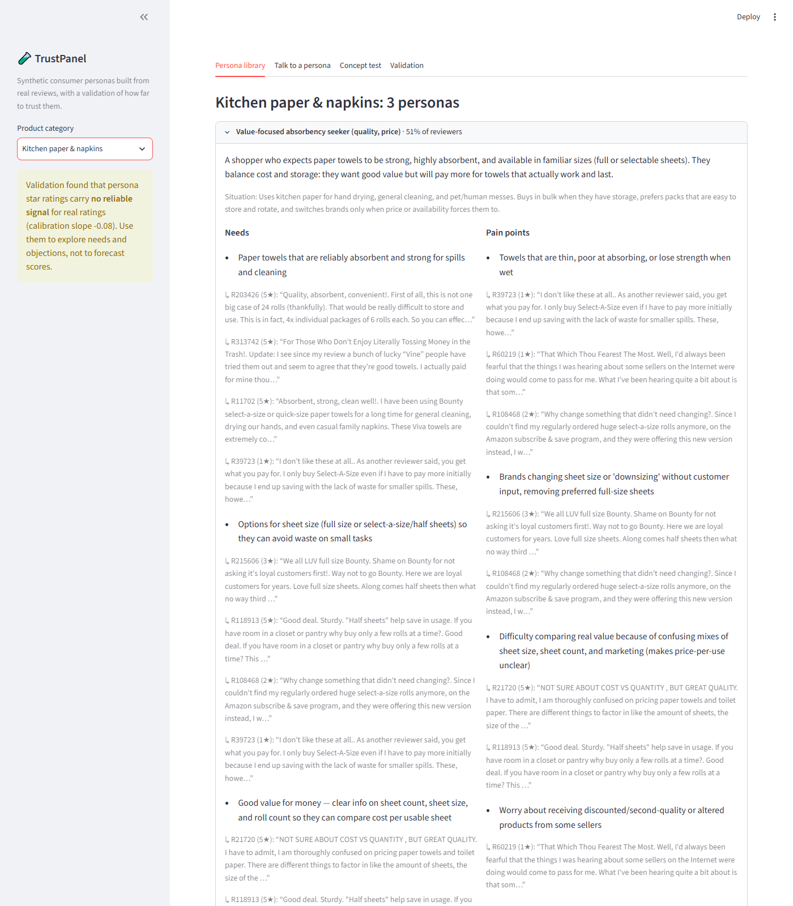
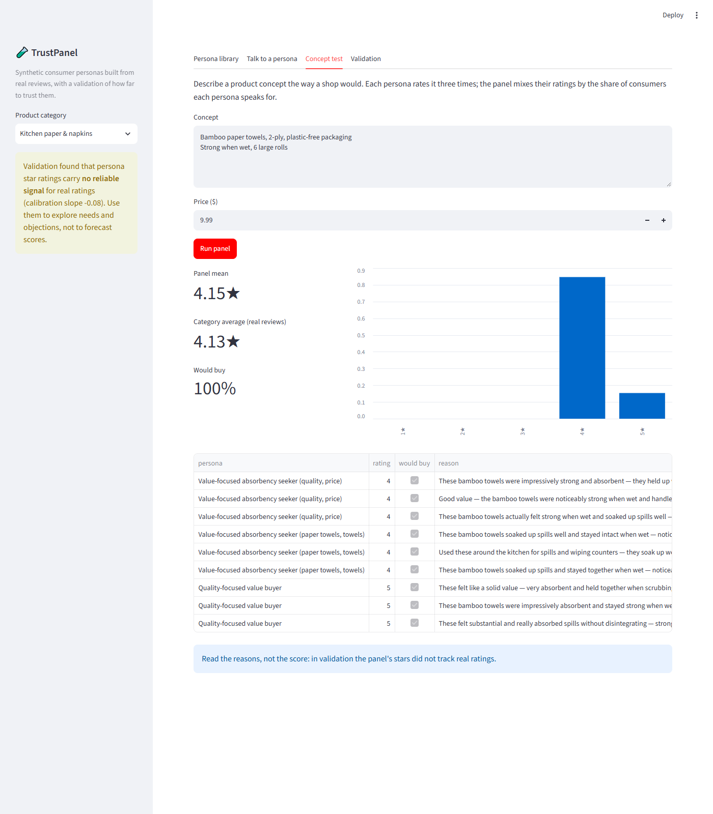
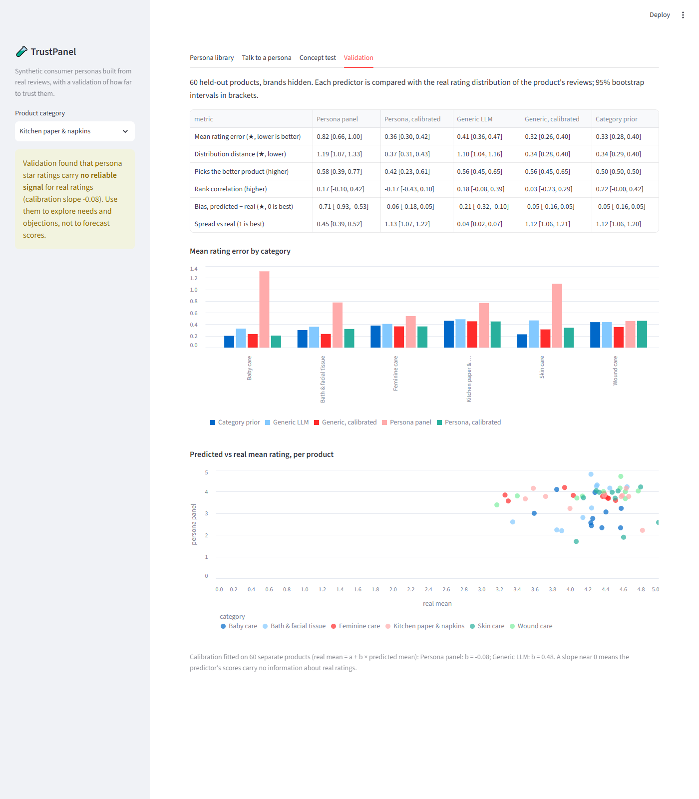

# TrustPanel

**Can synthetic consumers be trusted?** TrustPanel builds AI consumer personas from real product reviews, lets an innovation team talk to them and test concepts with them, and then checks their answers against what real consumers said.

The answer from this run is a clear, useful *no* for one use and an open *maybe* for another:

- As a forecast of **star ratings**, the persona panel was not reliable. It rated products 0.7 stars too low, and its scores carried no information about real ratings (calibration slope −0.08).
- As a way to **explore needs and objections**, the personas are grounded: every need and pain point cites the real reviews behind it.



## What it does

1. **Insights → segments.** It uses 353,137 real Amazon reviews (Amazon Reviews 2023, Health & Household) across six hygiene categories: feminine care, baby care, wound care, bath and facial tissue, kitchen paper and napkins, and skin care. Within each category, TF-IDF and k-means group reviewers who voice similar needs.
2. **Segments → personas.** For each segment, gpt-5-mini on Microsoft Foundry writes a persona card from about 12 representative reviews, drawn in proportion to the segment's real rating mix. Every need and pain point must cite review IDs. Citations the model invents are removed in code, and a need left without real evidence is dropped. Each persona is weighted by the share of reviewers it speaks for. The result is 18 personas with 415 citations.
3. **Personas → decisions.** A Streamlit prototype offers four views:
   - a persona library, with the review quotes behind each need
   - a chat with a persona
   - a concept test, in which every persona in the category rates a described concept three times and gives its reasons
   - a validation dashboard

| Concept test | Validation |
|---|---|
|  |  |

## How the personas were validated

The question is whether a persona panel's reaction to a product it has never seen matches real consumers' reactions.

- **Held-out products.** 60 test products (10 per category, each with at least 30 reviews) and 60 separate calibration products are excluded from the reviews used to build personas, so every rating is out of sample.
- **Brands hidden.** Panels see the product title, features, description and price, with the brand removed. This keeps the model from recalling how well-known products were rated.
- **Ground truth.** The real distribution of 1–5 star ratings in each product's reviews.
- **Three predictors on the same products:**
  - *Persona panel*: each persona rates the product 3 times, and the ratings are mixed by persona weight.
  - *Generic LLM*: the same model with no persona, given the same number of draws.
  - *Category prior*: the rating distribution of the category's other products, ignoring the product entirely.
- **Calibration.** On the calibration products, a linear map is fitted from predicted to real mean rating, then applied to the test products. This separates "off in level" (fixable) from "no signal" (not fixable). A slope near 0 means the scores tell you nothing about real ratings.
- **Metrics**, each with a 95% bootstrap confidence interval over products:
  - mean rating error
  - Wasserstein distance between distributions
  - error in the share of 1–2 star reviews
  - pairwise accuracy (picking the better of two same-category products whose real means differ by at least 0.3 stars)
  - Spearman correlation
  - bias
  - spread

## Results

60 held-out products; gpt-5-mini, low reasoning effort; 3 samples per persona.

| Metric | Persona panel | Persona, calibrated | Generic LLM | Generic, calibrated | Category prior |
|---|---|---|---|---|---|
| Mean rating error (★, lower is better) | 0.82 [0.66, 1.00] | 0.36 [0.30, 0.42] | 0.41 [0.36, 0.47] | **0.32** [0.26, 0.40] | 0.33 [0.28, 0.40] |
| Distribution distance (★, lower) | 1.19 [1.07, 1.33] | 0.37 [0.31, 0.43] | 1.10 [1.04, 1.16] | **0.34** [0.28, 0.40] | **0.34** [0.29, 0.40] |
| Error in share of 1–2★ (lower) | 0.22 [0.17, 0.27] | 0.09 [0.07, 0.10] | 0.15 [0.12, 0.17] | **0.08** [0.06, 0.10] | **0.08** [0.07, 0.10] |
| Picks the better product (higher) | 0.58 [0.39, 0.77] | 0.42 [0.23, 0.61] | 0.56 [0.45, 0.65] | 0.56 [0.45, 0.65] | 0.50 |
| Rank correlation (higher) | 0.17 [−0.10, 0.42] | −0.17 [−0.43, 0.10] | 0.18 [−0.08, 0.39] | 0.03 [−0.23, 0.29] | 0.22 [−0.00, 0.42] |
| Bias, predicted − real (★) | −0.71 [−0.93, −0.53] | −0.06 | −0.21 | −0.05 | −0.05 |
| Spread vs real (1 is best) | 0.45 | 1.13 | 0.04 | 1.12 | 1.12 |

Calibration slopes (real mean = a + b × predicted mean, fitted on the calibration products): persona panel **b = −0.08**, generic LLM **b = 0.48**.

**What this means:**

1. **Persona panels were systematically harsh.** They rated products 0.7 stars below real reviewers and gave far too many low ratings. An earlier run that drew equal numbers of quotes per star rating (`results/v1-star-balanced`) was just as harsh, so sampling is not the cause. A more likely cause is the persona framing itself: cards list pain points and deal-breakers, and the model role-plays a critic.
2. **The panel's scores held no signal for real ratings.** The calibration slope is about 0, so once the level is corrected the panel collapses to the category prior. Its pairwise accuracy of 0.58 has a confidence interval that includes chance.
3. **The generic LLM was barely more useful.** It gives almost the same rating every time (spread 0.04). After calibration it ties with the category prior but does not beat it.
4. **Star ratings depend on things a description does not show,** such as quality consistency, delivery and packaging damage. So any concept-only predictor has a low ceiling on this task.

**Recommendation:** Do not use synthetic panels to replace rating or acceptance surveys. Use them to generate hypotheses about needs, objections and wording, and check those hypotheses with real consumers. Before panels are trusted for a new kind of decision, validate them for that decision in the same way: held-out cases, simple baselines and calibration.

## Governance notes

- **Evidence over eloquence.** A persona states only what cited reviews support, and the app shows the quotes next to each claim.
- **Content filtering.** Intimate-hygiene reviews describe bodies plainly, and the Azure content filter sometimes blocks them, often only in combination. The persona builder adds quotes back one at a time and records how many were dropped (`filtered_quotes`). Panel calls that are blocked are counted in the results (`filtered_calls`, 0 in this run). The chat tells the user when a message was blocked.
- **Scope.** Incontinence products, and reviews that mention incontinence use, are deliberately excluded.
- **Data licence.** Amazon Reviews 2023 is for research use. Raw data, review text and the local persona file with quotes stay out of the repository (`data/` is ignored). `results/personas.json` holds the persona cards and segment statistics without review text.

## Run it

Requirements:
- Python 3.10+
- a Microsoft Foundry project with a gpt-5-mini deployment
- an Azure CLI login (`az login`)

```bash
pip install -r requirements.txt
cp .env.example .env               # set AZURE_AI_PROJECT_ENDPOINT and MODEL_DEPLOYMENT_NAME

python scripts/download_filtered.py   # streams ~14 GB, keeps hygiene products (~400 MB)
python scripts/prepare_data.py        # categories, test and calibration sets, insight corpus
python scripts/build_personas.py      # segments and 18 personas
python scripts/run_validation.py --name main --samples 3   # ~2,200 model calls
streamlit run app/app.py

python -m unittest discover -s tests -t .   # 30 tests, no network
```

Model answers are cached on disk under `data/cache/`, keyed by model, effort, prompt and sample, so re-running reproduces the same results at no cost.

## Layout

```
src/trustpanel/
  data.py         categories, product concepts (brand hidden), test/calibration split
  personas.py     segmentation, evidence sampling, persona writing with citation checks
  panel.py        persona panel, generic LLM and category prior predictions
  calibration.py  linear calibration and prior tilting
  validation.py   metrics and bootstrap intervals
  llm.py          Foundry client, JSON-schema answers, disk cache, content-filter handling
app/app.py        Streamlit prototype
results/          personas (no review text), predictions and summaries
```

## Limitations

- **Reviews are not research.** Amazon reviewers self-select, and star ratings mix product quality with delivery and expectations. Essity's own consumer research, including interviews and concept tests in care settings, would be a better source of insights and a better ground truth.
- **Scale.** The test covers 60 products and one model at one reasoning effort. The confidence intervals are wide, and a larger test set or more models could change the ranking results.
- **One kind of decision.** Only rating prediction was validated. Whether personas predict which complaints a product will get, or which of two concepts consumers prefer, is a separate question that needs its own validation.
